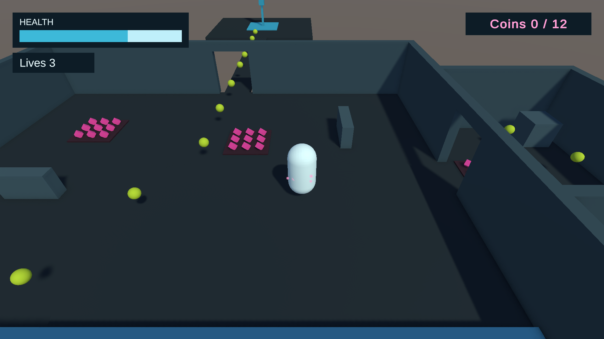
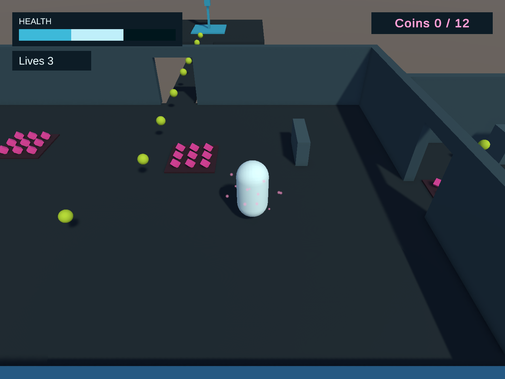
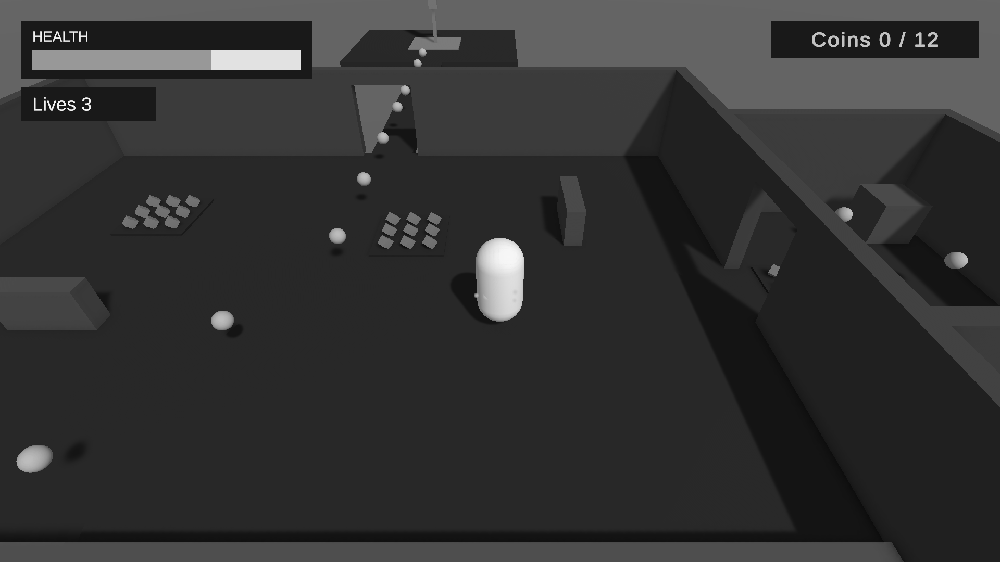

# CS464 Assignment 04 · Mohsin Raza Ojla · BSSE23040

**Video (90–180 s):** VIDEO_LINK_HERE

This repo started as a copy of my Assignment 03 repo, history and all. The five levels, the player, the guards and the hazards are the ones from Assignment 03. What is new here is the interface, the sound, the saving and the scene flow. I made and tested it in Unity 6000.6.2f1. The Unity 6.3 install on my computer would not start, so I could not try 6.3.

## What is in it

- **Seven scenes**, in the Scene List in play order: `MainMenu` (0), `Level01` to `Level05` (1 to 5), `Credits` (6). Every one of them can be played on its own.
- **One interface prefab**, `LevelUI`, with the HUD, the pause menu, the win screen, the game over screen and the loading bar. It is in all five levels, so a fix in the prefab reaches all five.
- **One `LevelLoader`**, the only script that loads a scene. It loads behind a bar and wraps from the Credits back to the menu.
- **One `SaveData`** class, the only script that writes a PlayerPrefs key.
- **One `SfxPlayer`** and **one `PersistentMusic`**, on a root object of every scene, each with the singleton check.
- **Keys:** arrow keys and Enter work in every menu, and a button is selected as each one opens. Esc opens and closes the pause menu, and goes back from the level list.
- **The sounds** (eight effects and one music loop) are made by `Docs/make_audio.py` from sine waves and noise. Nothing is recorded or downloaded.

To play: open `Assets/Scenes/MainMenu.unity` and press Play. Play goes to the newest level that is open. The level list has a button for each level, locked until it is unlocked.

## Settings

| Part | Setting | Value | Why |
|---|---|---|---|
| A | Harmony · base hue | triadic · 190° | 190° is a cyan-blue, and its triadic partners are 310° (magenta-pink) and 70° (yellow-green). The blue is the calm base, the pink is for the score and the hazards, the lime is for pickups. |
| A | Dark · mid · light | `#0E1F26` · `#3DB9D9` · `#E4F6FA` | The dark is every panel, the mid is the buttons and the health bar, the light is all text. They are far apart in value, so they stay apart in grayscale. |
| A | Accents | `#FF9FD6` · `#C6E83C` | The pink (310°) is the score and the win time. The lime (70°) is the boost text. In the level the same hues are the hazards (`#E0409F`) and the coins (`#AACD2D`, a bit darker so they stay apart from the player in grayscale). |
| A | Score text on its panel | 9.00 : 1 | Pink on the solid dark panel. |
| A | Lives, health, hint, title text on the panel | 15.18 : 1 | Light on the dark panel. The boost text (lime) is 12.08 : 1. |
| A | Button label on the button | 7.93 : 1 | A dark label `#0A171C` on the mid button. White on the same button would be only 2.30 : 1, which is why the label is dark. |
| A | Health fill, and lag bar, on the bar's track | 8.24 : 1 · 15.27 : 1 | Both are above 3 : 1, which is the rule for bars and icons. The lag bar is the paler one, `#BFEFFA`. |
| B | Music · SFX groups, as mixed | 0 dB · 0 dB | Both groups sit at 0 dB at slider 1. The music source is set to volume 0.4 (about −8 dB) so it stays under the effects. |
| B | Slider at 1 · 0.5 · 0.0001 | 0 dB · −6.02 dB · −80 dB | `Log10(value) × 20`, with 0.0001 as the lowest slider value. I checked all three in play mode. |
| C | Guard hum, in Level03 (also Levels 04 and 05) | logarithmic · Min 1.5 m · Max 15 m | Logarithmic fades like a real hum. 1.5 m is about the size of the guard. A guard starts to chase at 6 m and gives up at 9 m, so at 15 m you start to hear it before it sees you. |
| C | Goal beacon, in every level (checked in Level03) | linear · Min 3 m · Max 30 m | Linear drops evenly and is silent at 30 m, so you can follow it across a level. 3 m is the size of the goal pad. |
| C | AudioListener | on the player in the levels, on the camera in the two menu scenes | The level camera follows from about 11 m away, so its listener was removed and `ListenerOnPlayer` keeps one at the player. The menu scenes have a still camera, so the listener stays there. |
| D | `unlocked` | int · default 1 | Level 1 is always open. |
| D | `best1` … `best5` | float · `HasKey` first | A missing float reads 0, which would look like a perfect time, so the code asks `HasKey` first. |
| D | `MusicVolume` (and `SfxVolume`) | float · default 1 | A missing volume must come back as full, not as silent. |

## Answers

1. **What `Time.timeScale = 0` stops in my game, and what it doesn't:** It stops physics, the guards' patrol and chase, the crusher timers, the invincibility blink, the respawn delay and the health bar's lag bar, because they all use scaled time. It doesn't stop `Update`, so the player has to check `PauseMenu.IsPaused` or it would still read keys. It doesn't stop the sound, which needs `AudioListener.pause`, or the menus and the loading bar, which use unscaled time.

2. **What survives a LoadScene in my game, and how:** `Time.timeScale`, `AudioListener.pause` and the static `PauseMenu.IsPaused` survive on their own, so Resume runs before every load. The music and the SfxPlayer survive because they are on a root object with `DontDestroyOnLoad` and the singleton check. Unlocks and best times survive in PlayerPrefs on disk. The HUD, the loader and the GameManager are made again.

3. **Why every PlayerPrefs read in my game has a default:** On the first run nothing is saved, and a missing int reads 0. `unlocked` would be 0 and no level could be played, so its default is 1. A missing best time reads 0.0, which looks like the fastest run ever, so I check `HasKey` first. A missing `MusicVolume` would read 0 and the very first run would be silent, so its default is 1.

4. **An exception a forgotten unsubscribe would throw, and why mine can't:** If the `HealthBar` stayed subscribed to `Health.Damaged` after its scene was unloaded, the next hit would call it and it would touch its Images, which are destroyed. That throws a MissingReferenceException. Mine can't: the bar, the hit sound, the sparks and the flash each do `+=` in `OnEnable` and `-=` in `OnDisable`, which runs when they are destroyed, and each event belongs to one Health, not to a static.

## Credits

- Eight sound effects (pickup, hit, button, win, lose, checkpoint, guard hum, goal beacon) · Mohsin Raza Ojla · made with `Docs/make_audio.py` from sine waves and noise, no samples · in this repo · free to use
- Music loop (`music.wav`) · Mohsin Raza Ojla · made with the same script · in this repo · free to use
- Liberation Sans (the font TextMesh Pro uses) · Red Hat, Inc. · comes with the TextMesh Pro essentials in Unity · SIL Open Font License 1.1
- Lecture scripts for Lectures 08 to 10 and the levels from Assignment 01 · CS464 course material and my own earlier work
